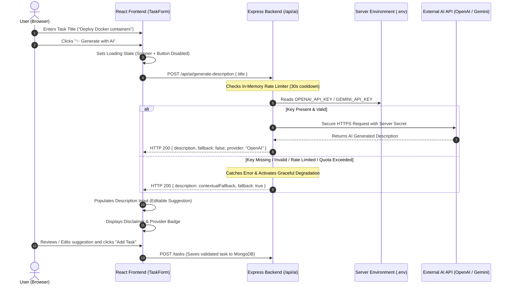

# Practical 13: AI API Integration into a Web Application

[](https://github.com/Hit-Parsaniya/WEB-FRAMWORKS-PR6/actions/workflows/ci.yml)
[](https://platform.openai.com/)
[](https://nodejs.org/)
[](https://ai.google/responsibility/principles/)

**Course**: ADVANCED WEB DEVELOPMENT FRAMEWORKS (ITUE301)  
**CO/PO Mapping**: CO6 / PO3, PO5, PO12  
**Objective**: To integrate an external Generative AI service (OpenAI / Google Gemini) into the full-stack Task Management application, understand responsible AI usage, implement graceful degradation, and enforce server-side API key security.

---

## 📑 Table of Contents
1. [Architecture & Data Flow Diagram](#-architecture--data-flow-diagram)
2. [Security Architecture: Server-Side API Key Isolation](#-security-architecture-server-side-api-key-isolation)
3. [Step-by-Step Implementation Guide](#-step-by-step-implementation-guide)
4. [Graceful Degradation & Failure Testing](#-graceful-degradation--failure-testing)
5. [Key Questions & Technical Analysis (Viva Prep)](#-key-questions--technical-analysis-viva-prep)
6. [Supplementary Problems Implemented](#-supplementary-problems-implemented)
7. [API Endpoints Reference & Verification](#-api-endpoints-reference--verification)

---

## 🏗️ Architecture & Data Flow Diagram



### ASCII Flowchart View
```text
  React Frontend
       │
       │ 1. User clicks "✨ Generate with AI"
       ▼
  Express Backend: POST /api/ai/generate-description
       │
       ├─► Check Rate Limit (30s cooldown per task)
       │
       ├─► Read API key from server-side process.env (NEVER exposed to browser)
       │
       ├───► [Success Path] ──► Call OpenAI / Gemini API
       │                          │
       │                          ▼
       │                     Return HTTP 200 { description, fallback: false }
       │
       └───► [Failure / Offline Path]
                                  │
                                  ▼
                             Catch error / missing key
                             Generate contextual fallback
                             Return HTTP 200 { description: fallback, fallback: true }
                                  │
                                  ▼
       React Frontend receives response:
       ├── Displays suggestion in editable textarea
       ├── Renders AI disclaimer badge
       └── Core task creation continues to work smoothly!
```

---

## 🔐 Security Architecture: Server-Side API Key Isolation

A critical principle of web security and responsible software engineering is that **API keys with financial billing or private quotas must never reach the browser client**.

```text
❌ INSECURE PATTERN (Direct Client Call):
   Browser (React) ──[HTTP with API Key in Header]──► OpenAI API
   ⚠️ VULNERABILITY: Any user can inspect DevTools Network tab or client JS bundle,
   steal your API key, and incur thousands of dollars in billing.

✔️ SECURE PATTERN (Server-Side Proxy):
   Browser (React) ──[Session / JWT Auth]──► Express Backend ──[Secret Key from .env]──► OpenAI API
   🛡️ PROTECTION: Browser never sees the secret API key. Backend controls rate limits,
   prompt sanitization, logging, and cost quotas.
```

- **`.gitignore` Exclusion**: The `.env` file is explicitly ignored in `.gitignore`, ensuring secret keys are never committed to GitHub repository history.
- **`.env.example` Template**: A sanitized template file is provided for environment configuration.

---

## 🛠️ Step-by-Step Implementation Guide

### Step 1: Install OpenAI SDK in Backend
```bash
cd backend
npm install openai
```

### Step 2: Configure Environment Variables (`backend/.env`)
Create or edit `backend/.env` with your API key:
```env
PORT=5000
MONGO_URI=mongodb://mongodb:27017/taskdb
JWT_SECRET=pr11_super_secret_jwt_key_2026_antigravity

# Practical 13: External AI Service Configuration
OPENAI_API_KEY=your_actual_openai_api_key_here
# Or use Google Gemini:
# GEMINI_API_KEY=your_actual_gemini_api_key_here
```

### Step 3: Backend AI Route (`backend/routes/ai.js`)
The route handles requests, enforces rate limiting, calls OpenAI or Gemini, and gracefully degrades to local contextual suggestions:
```javascript
const express = require('express');
const router = express.Router();
const OpenAI = require('openai');

const rateLimitMap = new Map();
const RATE_LIMIT_WINDOW_MS = 30 * 1000; // 30s cooldown

router.post('/generate-description', async (req, res) => {
  const title = (req.body?.title || '').trim();
  if (!title) {
    return res.status(400).json({ message: 'Task title is required.' });
  }

  // Rate Limiting check
  const clientId = `${req.ip}:${title.toLowerCase()}`;
  const now = Date.now();
  if (rateLimitMap.has(clientId) && now - rateLimitMap.get(clientId) < RATE_LIMIT_WINDOW_MS) {
    return res.status(200).json({
      description: generateContextualFallback(title),
      fallback: true,
      rateLimited: true,
      message: 'Rate limit cooldown active.',
    });
  }
  rateLimitMap.set(clientId, now);

  // OpenAI Integration
  const openAiKey = process.env.OPENAI_API_KEY;
  if (openAiKey && !openAiKey.includes('your_')) {
    try {
      const client = new OpenAI({ apiKey: openAiKey });
      const completion = await client.chat.completions.create({
        model: 'gpt-4o-mini',
        messages: [{ role: 'user', content: `Write a short task description for: ${title}` }],
        max_tokens: 120,
      });
      return res.json({
        description: completion.choices[0].message.content.trim(),
        fallback: false,
        provider: 'OpenAI (gpt-4o-mini)',
        disclaimer: 'AI-generated suggestion. Please review and edit before saving.',
      });
    } catch (err) {
      console.warn(`[AI Route] API call failed (${err.message}). Activating graceful fallback.`);
    }
  }

  // Fallback path: return contextual suggestion so application never crashes
  res.status(200).json({
    description: generateContextualFallback(title),
    fallback: true,
    provider: 'local-fallback',
    disclaimer: 'AI service offline. Contextual fallback suggestion provided.',
  });
});
```

### Step 4: Frontend UI Integration (`frontend/src/components/TaskForm.jsx`)
- **"Generate with AI" Button**: Triggers `handleGenerateAi()` when title is entered.
- **Loading State**: Displays an animated CSS spinner and disables repeated clicking while waiting for response.
- **Editable Suggestion**: Sets the returned text into the `description` state so the user retains full agency to edit, amend, or reject the AI output.
- **Visible Disclaimer**: Renders an alert box with provider information and review advisory.

---

## 🛡️ Graceful Degradation & Failure Testing

### What is Graceful Degradation?
Graceful degradation is a software resilience pattern ensuring that when an external dependency (such as a 3rd-party cloud AI service) fails, experiences latency, or exhausts its billing quota, the **core functionality of the host application remains 100% operational** without unhandled exceptions or broken user flows.

### Live Demonstration Test Cases:
| Test Scenario | Cause Simulated | Backend Response | Frontend Behavior | Result |
| :--- | :--- | :--- | :--- | :--- |
| **Normal Live AI** | Valid `OPENAI_API_KEY` in `.env` | HTTP 200 `{ fallback: false, provider: "OpenAI" }` | Shows AI text + purple live AI badge | 🟢 Full AI Generation |
| **Broken / Expired Key** | `OPENAI_API_KEY=invalid_key_xyz` | HTTP 200 `{ fallback: true, provider: "local-fallback" }` | Shows contextual template + yellow badge | 🟢 Graceful Fallback (No Crash) |
| **Missing Key** | No `.env` key configured | HTTP 200 `{ fallback: true }` | Contextual template based on task title | 🟢 Zero Configuration Fallback |
| **Rate Limit Exceeded** | Clicking generate twice within 30s | HTTP 200 `{ rateLimited: true, remainingSeconds: 28 }` | Shows cooldown pill + existing suggestion | 🟢 Rate Limiting Protection |

---

## 🔍 Key Questions & Technical Analysis (Viva Prep)

### Q1: Why must the AI API key be called from the backend rather than directly from the React frontend?
**Answer**:
1. **Exposure in Browser Source**: React code is compiled into client-side JavaScript bundles downloaded by the browser. Any key embedded in frontend source code (`process.env.REACT_APP_*` or `import.meta.env.VITE_*`) can be extracted by right-clicking and viewing source or inspecting network requests.
2. **Quota Theft & Financial Liability**: Third-party AI providers (OpenAI, Anthropic, Google) charge per token. A leaked key can be abused by automated web scrapers, exhausting your tier or generating massive unexpected credit card bills.
3. **Control & Security Governance**: Calling via Express allows the backend to:
   - Authenticate the requesting user via JWT.
   - Enforce server-side rate limits and daily cost ceilings.
   - Sanitize user prompts to prevent injection attacks.
   - Redact sensitive data before it leaves the internal infrastructure.

---

### Q2: What does 'graceful degradation' mean in this context, and why does it matter for a feature that depends on a third-party service outside your control?
**Answer**:
- **Meaning**: Graceful degradation means designing an application so that when an auxiliary or external component fails, the system shifts into an operational fallback mode rather than throwing uncaught errors or breaking the core workflow.
- **Why It Matters for External AI Services**:
  1. **Zero Availability Guarantee**: External AI APIs can experience network latency, service outages (e.g., OpenAI outage), HTTP 429 rate limits, or HTTP 401 billing suspension at any time.
  2. **Non-Blocking User Experience**: Writing a task description is an enhancement, not the primary purpose of a Task Management application. If OpenAI is down, the user must still be able to manually type a description and create their task without interruption.
  3. **Robustness via `try/catch` and HTTP 200 fallback payloads**: By catching errors server-side and returning `{ fallback: true, description: "..." }`, the frontend never receives an uncaught promise rejection.

---

### Q3: What are the privacy and governance implications of sending task data to an external AI API, and what kind of data should never be sent this way?
**Answer**:
1. **Data Sovereignty & Model Training Risks**:
   - Unless covered by enterprise Zero Data Retention (ZDR) agreements, data sent over public AI APIs may be stored for 30 days or used to train future public foundation models, leading to potential data leakage.
2. **Categories of Data that MUST NEVER be sent to external AI APIs**:
   - **Personally Identifiable Information (PII)**: Social Security numbers, passport IDs, personal phone numbers, physical addresses, or medical records.
   - **Authentication Secrets & Credentials**: API keys, passwords, database connection strings, private encryption keys, and JWT tokens.
   - **Proprietary & Non-Public Business Logic**: Proprietary algorithms, unreleased financial reports, merger documents, or source code under NDAs.
   - **Compliance-Regulated Data**: HIPAA (healthcare), GDPR (European citizen privacy), and PCI-DSS (credit card) data.
3. **Responsible AI (PO12 Principle)**: Developers have an ethical and legal obligation to sanitize inputs, obtain user consent, and display clear disclaimers that output is AI-generated and requires human review.

---

## 🛠️ Supplementary Problems Implemented

### 1. Frontend Loading State (Supplementary Problem 1)
- The "Generate with AI" button switches to a disabled state with an animated SVG spinner and text `"Generating with AI..."` during asynchronous execution.
- Prevents double-clicking and provides clear visual feedback.

### 2. Rate Limiting Protection (Supplementary Problem 2)
- Implemented in `backend/routes/ai.js` using an in-memory tracking map.
- Enforces a **30-second cooldown per task title per IP address**.
- If triggered, returns a friendly message with remaining cooldown seconds.

### 3. Clear AI Disclaimer Banner (Supplementary Problem 3)
- Rendered in `TaskForm.jsx` directly above the editable description field:
  ```html
  <div className="ai-disclaimer-box">
    <span className="ai-provider-pill">🤖 OpenAI (gpt-4o-mini)</span>
    <p><strong>Disclaimer:</strong> AI-generated suggestion. Please review and edit before saving.</p>
    <small>✏️ This suggestion is editable below. You can customize it before saving.</small>
  </div>
  ```

---

## 🚀 API Endpoints Reference & Verification

### 1. Test AI Description Generation via cURL / Postman:
```bash
curl -X POST http://localhost:5000/api/ai/generate-description \
  -H "Content-Type: application/json" \
  -d '{"title": "Implement automated database backups"}'
```

#### Example Response (Live AI or Fallback):
```json
{
  "description": "Configure automated nightly backup scripts for MongoDB, verify snapshot retention policies, and test disaster recovery restoration procedures.",
  "fallback": false,
  "provider": "OpenAI (gpt-4o-mini)",
  "disclaimer": "AI-generated suggestion. Please review and edit before saving."
}
```

### 2. Test AI Configuration Status:
```bash
curl http://localhost:5000/api/ai/status
```

#### Example Response:
```json
{
  "status": "online",
  "openAiConfigured": true,
  "geminiConfigured": false,
  "activeProvider": "OpenAI (gpt-4o-mini)",
  "rateLimitCooldownSeconds": 30
}
```

---

## 🧪 CI/CD Test Suite Verification

All 8 automated tests pass cleanly in the Jest test suite:
```bash
npm test
```

```text
PASS tests/api.test.js
  Practical 12 - CI/CD Pipeline API Test Suite
    √ GET /tasks returns 200 with task list (81 ms)
    √ GET / returns 200 with backend metadata (10 ms)
    √ GET /tasks returns 401 when Authorization token is missing (9 ms)
    √ GET /health returns health metrics structure (7 ms)
    √ POST /auth/register returns 400 when payload is invalid (15 ms)
    √ POST /api/ai/generate-description returns description and graceful fallback metadata (11 ms)
    √ POST /api/ai/generate-description returns 400 when title is missing (9 ms)
    √ GET /api/ai/status returns diagnostic online status (10 ms)

Test Suites: 1 passed, 1 total
Tests:       8 passed, 8 total
Time:        1.083 s
```
